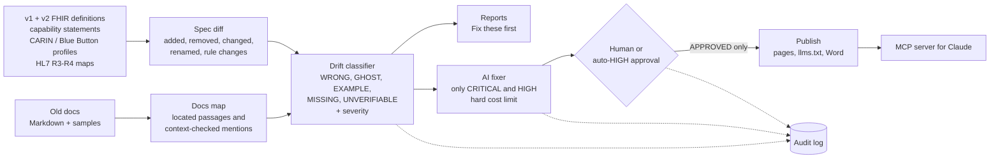

# TruthLayer AI

[](https://github.com/aayushnamdev/truthlayer-ai/actions/workflows/ci.yml)
[](https://github.com/aayushnamdev/truthlayer-ai/actions/workflows/truthlayer-check.yml)

**TruthLayer AI checks whether API documentation is still true after the API changes, fixes only the parts that broke, and republishes a verified copy that people and AI assistants can trust.**

## The problem
When an API moves to a new version, the old documentation keeps saying things that are no longer true. Nobody notices until a developer's code breaks. TruthLayer compares the old docs with the new API definitions, lists every claim that went stale, and proposes small, reviewable fixes.

Test case: the CMS **Blue Button 2.0** Medicare API, from **v1 (FHIR STU3)** to **v2 (FHIR R4)**. The old v1 booklet was removed from CMS's website; we recovered it from CMS's public GitHub history (see `truth/SOURCES.md`).

## How it works

Detection is plain, repeatable code. **AI is used only to write the fixes**, never to decide what is wrong.

## Quickstart
Needs Python 3.11 or newer.
```bash
git clone https://github.com/aayushnamdev/truthlayer-ai && cd truthlayer-ai
make install          # pip install -e ".[dev]"
make run              # check + fix (MOCK mode) + publish on the Blue Button case
make app              # open the dashboard at http://localhost:8501
make demo             # the same on SYNTHETIC test data
make test             # pytest + ruff + mypy
```
Without an API key everything runs in **MOCK mode**: all checking is the same, and fixes come from a simple built-in stand-in that is labelled MOCK everywhere. To use the real AI, copy `.env.example` to `.env`, add `ANTHROPIC_API_KEY`, then:
```bash
truthlayer ai-test        # ONE real call, prints real token use
truthlayer fix --live     # real fixes, inside the cost limit
```
The key is read only from the environment (or `.env`, which git ignores). It is never printed, logged or saved.

### Cost and safety limits (`truthlayer.yml`)
Hard limit **$1.00** per ledger (`fixes/cost-ledger.json`), checked **before every call**; at most **25 calls** (retries count); model **claude-haiku-5-5 only**; **400** output tokens; only **CRITICAL and HIGH** findings are sent. Prices in the file are assumptions and the check doubles them, so a wrong guess still stays under the limit.

## Commands
| Command | What it does |
|---|---|
| `truthlayer check [--fail-on SEVERITY]` | Find drift and style problems; write `reports/drift-report.md` (plain English, "Fix these first" first) and `.json`. Exit 1 if a finding at or above the threshold exists. |
| `truthlayer style` | Run only the style rules (`rules/healthplan-style.yml`, SYNTHETIC). |
| `truthlayer fix [--live] [--max-calls N] [--retry-unparseable]` | Make fix proposals (PENDING). MOCK unless `--live` and a key. |
| `truthlayer ai-test` | One real AI call to measure real tokens before a full run. |
| `truthlayer review [--pending]` | Show proposals as before/after. |
| `truthlayer approve ID` / `approve --auto-approve-high` / `reject ID` | Decide. Auto only for HIGH-confidence changes; recorded as approver `auto`. |
| `truthlayer publish` | Write `publish/` (pages, `llms.txt`, `llms-full.txt`, `export.docx`). Only APPROVED fixes are applied. |
| `truthlayer run [--auto-approve-high] [--live]` | check + fix + approve + publish, with timing. |
| `truthlayer app` | Start the web dashboard. |
| `truthlayer demo` | Everything on the SYNTHETIC fixtures. |
| `truthlayer serve-mcp` | Start the MCP server (see below). |
| `truthlayer score CSV` | Score against a ground-truth list. Only after tuning is finished. |

Findings have a **label** (WRONG: the text states something now false; NEEDS_NOTE: it only names a changed field; GHOST; EXAMPLE; MISSING; UNVERIFIABLE) and a **severity** (CRITICAL: removed, renamed or now-required things named in the text; HIGH: wrong examples and rule changes; MEDIUM: missing required items; LOW: missing optional additions). Low-confidence findings say "ask a human".

## Dashboard
On another device (for example your phone), run `truthlayer app --host 0.0.0.0` and open `http://<your computer's Wi-Fi address>:8501`; there is no password, so use home Wi-Fi only.

`make app` opens a Streamlit page with: **Home** (the bundled Blue Button case, or upload two sets of specs and a docs folder), **Overview** score cards (findings by severity, CMS recall, real drift found, run time, AI cost), **Fix these first** with severity/label filters, **Finding detail** (old booklet text next to the v2 truth with differences highlighted, the AI fix, Approve / Reject), **Downloads** (verified Markdown, `llms.txt`, Word export, audit log) and an **Audit log** viewer. A banner shows MOCK mode when no key is set. The dashboard never calls the AI on page load; it runs only when you press "Ask AI for a fix", inside the cost limit.

## GitHub Action
`.github/workflows/truthlayer-check.yml` runs TruthLayer in MOCK mode (no key, no AI) when files in `data/` or `docs/` change. It uploads the report as an artifact, writes a summary to the job, and **fails when CRITICAL drift exists**. Change the threshold with the repository variable `TRUTHLAYER_FAIL_ON` (CRITICAL, HIGH, MEDIUM, LOW or NONE), the `fail_on` input of a manual run, or `thresholds.fail_on_severity` in `truthlayer.yml`. Note: the bundled Blue Button booklet really is out of date, so with the default threshold this repo's own check fails by design. `.github/workflows/ci.yml` runs pytest, ruff and mypy on every push, with no AI calls.

## The honesty rule and both scores
Detection is built and tuned only from the v1/v2 definitions, the docs and SYNTHETIC fixtures. CMS's own list of 35 changes (`truth/v1-v2-changes.csv`) is opened only at the scoring step; the first score is reported unchanged, and later improvements are reported separately with every change listed.

| | First score (`reports/results.md`, blind) | Second score (`reports/results-v2.md`, **not blind**) |
|---|---|---|
| CMS changes caught | 21 of 35 (60%) | 32 of 35 (91%) |
| Missed | 12 | 1 |
| Findings (all) | 65 | 155 (9 critical, 22 high, 39 medium, 85 low) |
| Strict precision (on CMS's list) | 43% | 28% (the extra findings are real differences CMS did not list) |
| Run time | 0.34 s | 0.63 s |

A third score (`reports/results-v3.md`) splits WRONG into WRONG (3) and NEEDS_NOTE (17); recall stays 32 of 35.

The second score was taken after I saw what the first one missed, so it shows known gaps being closed, not an independent test. The real-AI fixer was run once on the Blue Button case: 25 calls, about $0.04; 2 text fixes, 15 correct "nothing to change", 7 unparseable (since fixed in the prompt). See `reports/results-v2.md`.

## Limitations
- Compares what machine-readable definitions say. HTTP headers, policies and prose-only rules cannot be proven; they are listed as UNVERIFIABLE for a human.
- Renames not in HL7's official maps are guesses and always say "ask a human".
- Matching booklet text to elements is rule-based. It is cautious (a bare word like "Coverage" does not match a field) and can miss loosely worded passages.
- Many findings are low-value optional additions (LOW, in an appendix). About 6 are only must-support flags.
- Only Patient, Coverage and ExplanationOfBenefit are modelled. Fixes to JSON sample files can be approved but are not published.
- The AI fixer was run on 24 findings only; most findings are about bare field names, so it rightly changed little.

## Connect the MCP server to Claude
The server reads only `publish/` and `reports/`. Tools: `search_docs(query, api_version)`, `get_page(id)`, `get_drift_report()`, `get_change(element)`. First run `make run`, then:
```bash
claude mcp add truthlayer -- truthlayer --root /full/path/to/truthlayer-ai serve-mcp
```
For Claude Desktop add to `claude_desktop_config.json`:
```json
{ "mcpServers": { "truthlayer": { "command": "truthlayer", "args": ["--root", "/full/path/to/truthlayer-ai", "serve-mcp"] } } }
```

## Docker
```bash
docker build -t truthlayer .
docker run -p 8501:8501 -e ANTHROPIC_API_KEY truthlayer     # dashboard; leave -e out for MOCK mode
```

## Data and provenance
Every saved file is listed in `truth/SOURCES.md` with its URL, date and SHA256. Anything we wrote (style rules, test fixtures) is marked SYNTHETIC. See `CHANGELOG.md` for what changed between versions.
